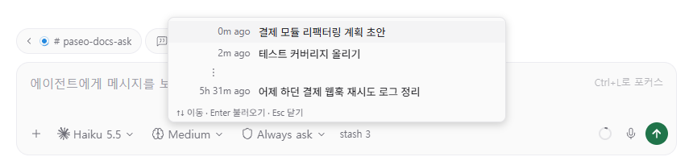

# paseo-textarea

[English](README.md)

에이전트 메시지 입력창에 편집기 단축키를 더하는 [Paseo](https://paseo.sh) 플러그인.



## 설치

```bash
paseo plugin add git:nasus1263/paseo-textarea
```

데몬에서 플러그인이 켜져 있어야 한다(**Settings → Plugins → Enable plugins**). Paseo `>=0.16.0-beta.2`.

## 단축키

| 키 | 동작 |
|---|---|
| Shift+Enter | 들여쓰기 유지, `- ` / `1. ` 목록 이어쓰기 |
| Tab / Shift+Tab | 선택 줄 들여쓰기 / 내어쓰기 (Shift+Tab은 아래 주의 참고) |
| Ctrl+D | 줄 삭제 |
| Ctrl+L | `- ` 글머리 토글 |
| Alt+↑ / Alt+↓ | 줄 이동 |
| Ctrl+Space | 줄 전체 선택 |
| Ctrl+C / Ctrl+X (선택 없음) | 현재 줄 복사 / 잘라내기 |
| 선택 후 따옴표·괄호 | 선택 영역 감싸기 |
| 빈 줄에서 백틱 세 번째 | 닫는 펜스 추가 |
| `(` `<` `{` `` ` `` | 닫는 글자를 함께 넣고 커서를 사이에 둠 |
| `->` / `<-` | `→` / `←` 로 바뀜 |
| Ctrl+S | stash / unstash (아래 참고) |

Enter, Ctrl+Enter는 Paseo 기본 동작 그대로.

## Stash

쓰던 내용을 워크스페이스별로 치워 둔다. 데몬의 `~/.paseo/plugin-data/paseo-textarea/stash.json`에 저장된다.

- 내용이 있으면 Ctrl+S가 전체를(일부를 골랐으면 그 부분만) 치운다.
- 입력창이 비어 있으면 Ctrl+S가 되돌린다. 하나면 바로, 여럿이면 목록에서 고른다(↑↓, Enter, Esc).
- 입력창의 **stash N**을 눌러도 목록이 열린다. 목록은 넣은 지 얼마나 됐는지를 보여 주고, 3시간 넘게 벌어진 항목 사이에는 `⋮`를 넣는다.
- 쓰던 내용이 있는 채로 되돌리면 쓰던 내용은 stash로 들어간다.

## 주의

- 데스크톱과 웹 전용.
- Paseo 화면 구조로 입력창을 찾으므로 Paseo 업데이트 시 깨질 수 있다.
- 자동완성 목록이 열려 있으면 Enter·Tab·방향키는 Paseo가 처리한다.
- 에이전트 입력창의 Shift+Tab은 Paseo의 **에이전트 모드 전환** 단축키가 먼저 가져간다. 내어쓰기로 쓰려면 Paseo 키보드 단축키 설정에서 그 단축키를 바꾼다.
