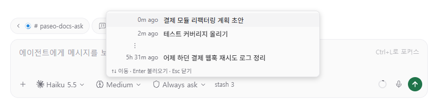

# paseo-textarea

[한국어](README.ko.md)

A [Paseo](https://paseo.sh) plugin that adds editor-style keys to the agent message composer.



## Install

```bash
paseo plugin add git:nasus1263/paseo-textarea
```

Plugins must be enabled on the daemon (**Settings → Plugins → Enable plugins**). Requires Paseo `>=0.16.0-beta.2`.

## Keys

| Key | Action |
|---|---|
| Shift+Enter | New line that keeps the indent and continues `- ` / `1. ` lists |
| Tab / Shift+Tab | Indent / dedent the selected lines (see the Shift+Tab note) |
| Ctrl+D | Delete the line |
| Ctrl+L | Toggle `- ` bullets |
| Alt+Up / Alt+Down | Move lines |
| Ctrl+Space | Select whole lines |
| Ctrl+C / Ctrl+X (no selection) | Copy / cut the current line |
| Quote or bracket over a selection | Wrap the selection |
| Third backtick on an empty line | Add the closing fence |
| `(` `<` `{` `` ` `` | Insert the closing character and put the caret between |
| `->` / `<-` | Turn into `→` / `←` |
| Ctrl+S | Stash / unstash (see below) |

Enter and Ctrl+Enter keep Paseo's default behavior.

## Stash

Set aside what you are writing, per workspace. Stored on the daemon in `~/.paseo/plugin-data/paseo-textarea/stash.json`.

- With text in the composer, Ctrl+S stashes all of it, or only the selection.
- On an empty composer, Ctrl+S brings one back: directly when there is one, from a list when there are several (arrows, Enter, Esc).
- **stash N** in the composer opens the same list. Each row shows its age, and a `⋮` row marks gaps of 3 hours or more.
- Bringing one back while you have text stashes that text first.

## Notes

- Desktop and web only.
- It finds the composer through Paseo's page markup, so a Paseo update can break it.
- While the autocomplete list is open, Enter, Tab, and the arrow keys go to Paseo.
- In an agent composer, Paseo's own **Cycle agent mode** shortcut takes Shift+Tab first. Rebind it in Paseo's keyboard shortcuts to use Shift+Tab for dedent.
